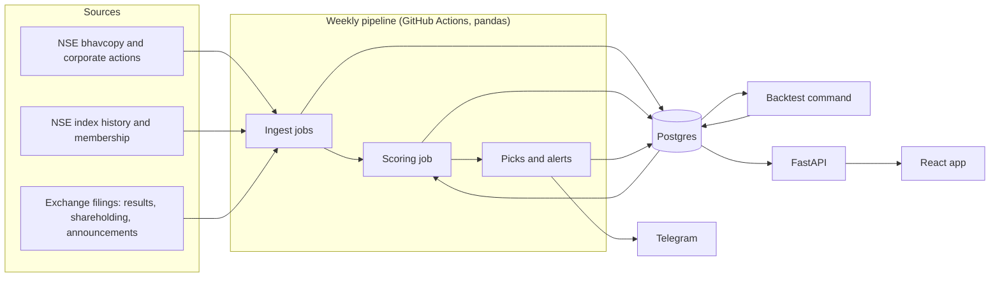

# Radar — Architecture

How the system is put together, why it is built this way, and which alternatives were
considered and rejected. Product, data and method decisions are in
[DECISIONS.md](DECISIONS.md); the build order is in [PHASE.md](PHASE.md).

## The system in one picture

## Design principles

The stack follows from five facts about the project.

1. **The data is small.** About 500 stocks, 250 trading days a year and 10 years is
   roughly 1.25 million price rows. Everything fits in memory on a laptop.
2. **The work is batch.** Inputs change daily at most, and fundamentals change quarterly.
   Nothing needs to be computed while a user waits.
3. **Correctness matters more than speed.** The backtest is only worth showing if
   look-ahead and survivorship are ruled out, so the design favours things that are
   easy to test.
4. **It must cost nothing to run.** One person, part-time, free tiers only.
5. **It is a portfolio project.** The tools should be ones a backend or data team
   would recognise, used at a scale that justifies them.

## How the pieces fit

| Layer | What it does | Built with |
|---|---|---|
| Ingest | Downloads files, maps symbols to `stock_id`, writes raw rows | Python, pandas |
| Storage | Holds raw data, scores, picks and run logs | Postgres, Alembic |
| Scoring | Computes factor scores and evidence for a given date | pandas |
| Backtest | Replays scoring over past dates and measures returns | pandas, one CLI command |
| Scheduling | Runs ingest and scoring weekly, logs each step | GitHub Actions, `pipeline_runs` |
| API | Serves stored scores, evidence and scorecard | FastAPI |
| Frontend | Three mobile-first screens | React |
| Alerts | Sends score changes and pipeline failures | Telegram bot |
| ML experiment | Challenger ranker, kept separate from the live path | LightGBM, SHAP |

Three structural rules hold the design together:

- **Scores are computed in batch and stored.** The API only reads. A page load never
  triggers a calculation.
- **Scoring is a function of a date.** The live pipeline and the backtest call the
  same code with a different `as_of`. There is no separate backtest implementation
  that could drift from the live one.
- **The database is the only shared state.** Jobs do not call each other. Each reads
  from Postgres and writes back to it.

## Choices and rejected alternatives

### Database: Postgres

| Alternative | Why not |
|---|---|
| DuckDB first, Postgres later (the PRD's plan) | Means building the schema twice and migrating mid-project. DuckDB is a single-file, single-writer database, which is awkward to put behind a deployed API. |
| SQLite | Would work at this size. Rejected because it lacks JSONB for evidence, has loose typing for money columns, and is not what a deployed service normally runs on. |
| Postgres + TimescaleDB (the PRD's plan) | Built for billions of time-series rows. At about a million rows a plain index on `(stock_id, date)` is enough, and the extension is not available on most free tiers. |
| MongoDB or another document store | The data is relational: stocks, dated prices, dated filings, joined on keys and date ranges. |

### Point-in-time storage: append-only rows with `reported_at`

| Alternative | Why not |
|---|---|
| Latest value per period, overwritten on restatement | Loses what was known on a past date, which is the cause of look-ahead bias. |
| Full database snapshot per date | Simple to reason about but stores the same data hundreds of times. |
| Full bitemporal model (valid time and transaction time on every table) | More machinery than needed. Only filings are restated; prices and index levels are not. |

### Price adjustment: raw prices, adjusted at query time

| Alternative | Why not |
|---|---|
| Store adjusted prices | Every new split or bonus changes all earlier adjusted prices, so history is rewritten each time. A wrong corporate action cannot be corrected without a reload. |
| Use a vendor's pre-adjusted series | Adjustment method is hidden, usually excludes delisted stocks, and cannot be tested. |

### Pipeline: pandas jobs on a GitHub Actions schedule

| Alternative | Why not |
|---|---|
| Airflow, Prefect or Dagster | Each needs an always-on server and its own database. The pipeline is a handful of steps run once a week; an orchestrator would be the largest component in the system. |
| Cron on a rented server | Costs money, and the schedule, logs and secrets would live outside the repo. |
| Spark or Dask | For data that does not fit on one machine. This data fits in memory many times over. |
| Polars | A reasonable choice, and faster. pandas was kept because speed is not the constraint and its ecosystem is wider. |

Known weakness: exchange sites may block cloud hosts. Phase 0 tests this, and the
fallback is a self-hosted runner or local cron with the same job code.

### Run logging: a `pipeline_runs` table

| Alternative | Why not |
|---|---|
| GitHub Actions logs only | They expire and cannot be queried or shown in the app. |
| A hosted observability tool | Another account and another free tier for a need one table covers. |

### Serving: precomputed scores behind a read-only API

| Alternative | Why not |
|---|---|
| Compute scores on request | Slow, and the same request could return different answers as data arrives. Stored scores are fixed and auditable per date. |
| Cache layer (Redis) | Nothing is slow enough to need one. The API reads indexed rows. |

### API: FastAPI

| Alternative | Why not |
|---|---|
| Django | Brings an ORM, admin and auth that a read-only API with no logins does not use. |
| Flask | Would work. FastAPI adds typed request and response models and generated API docs for no extra effort. |
| No API, frontend queries the database directly | Exposes the database to the internet and ties the frontend to the schema. |

### Frontend: minimal React

| Alternative | Why not |
|---|---|
| Streamlit | Fastest to build, but layout control is limited, mobile-first screens are hard, and it does not show a separate API and frontend. |
| Next.js | Server rendering and routing features are not needed for three screens over a JSON API. |
| Server-rendered templates (Jinja) | Would work for three pages. React was chosen for the learning goal and the tap-to-explain tooltips. |

### System shape: one repo, one API service, one database

| Alternative | Why not |
|---|---|
| Microservices | No independent teams, scaling needs or deploy schedules to separate. |
| Message queue or event stream (Kafka, RabbitMQ) | Nothing is real-time. Jobs run in a fixed order once a week. |
| Kubernetes | One container and one database do not need a cluster. |

Docker Compose runs the same setup locally and on the host.

### Schema changes: Alembic migrations

| Alternative | Why not |
|---|---|
| Hand-run SQL files | No record of which changes a given database has had. |
| Let the ORM create tables | Cannot evolve a schema that already holds data. |

### Red flags: keyword rules on exchange announcements

| Alternative | Why not |
|---|---|
| FinBERT sentiment on news (the PRD's plan) | Trained on English financial news, not Indian exchange announcements. Output is hard to verify and needs a model served somewhere. Deferred, not dropped. |
| An LLM call per announcement | Costs money per run and gives answers that can change between runs. |

### ML ranker: LightGBM with SHAP, outside the live path

| Alternative | Why not |
|---|---|
| Neural network | Too little data: a few thousand stock-quarter rows with overlapping labels. Gradient-boosted trees are the standard for small tabular data. |
| XGBoost or CatBoost | Equivalent for this purpose. LightGBM was the PRD's choice and there is no reason to change it. |
| Make the ML ranker the main score | Fixed rules are explainable and cannot overfit. The ranker has to earn its place by winning on unseen years. |

### Hosting: one free-tier host

| Alternative | Why not |
|---|---|
| A cloud provider's managed services (AWS, GCP) | Easy to exceed a free tier by accident, and more setup than one service and one database need. |
| Serverless functions | Cold starts and connection limits against Postgres, for an API with almost no traffic. |

Known weakness: free tiers sleep when idle and may limit or expire databases. The
whole database can be rebuilt from source files by rerunning the pipeline.

## What would change this design

| If this happens | Then |
|---|---|
| Universe grows to all NSE stocks with intraday data | Revisit TimescaleDB or a columnar store |
| Pipeline grows past about ten dependent steps | Revisit an orchestrator |
| Scheduled downloads are blocked from cloud hosts | Move scheduling to a self-hosted runner or local cron |
| Adjusted-price queries become slow | Add a materialised view |
| Logins or personalised output are added | Revisit the API framework, hosting and regulation |
